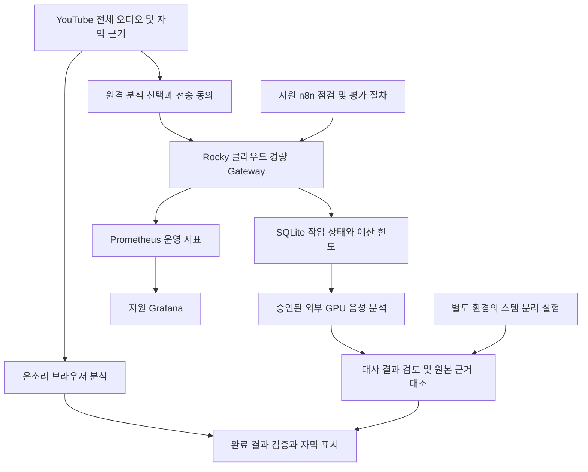

# 온소리 자막 in YouTube 추가 업데이트 계획 및 승인 전 연결 준비

작성일: 2026-10-30  
대상: 브라우저 분석 방식의 온소리 0.3.3 및 후속 업데이트  
상태: **설계·로컬 준비 완료 / 자원 승인과 실제 서비스 연결 대기**

## 1. 이번 업데이트의 방향

온소리의 다음 단계는 단순히 음성 인식 모델을 큰 모델로 바꾸는 일이 아니다. **대사의 오류를 줄이고, 대사·배경 음악·효과음을 구분해 이해하기 쉬운 자막을 제공하는 것**을 목표로 한다. 현재의 영상 전체 분석, 분석 완료 후 자막 표시, 대사·효과음 단락별 일정한 글자 크기, X·Y 위치 조절은 유지한다.

모두의 AI 실험실 클라우드는 작업 접수·결과 관리·외부 분석 연결에 사용한다. n8n은 점검과 평가 절차를 자동화하고, Grafana는 오류와 처리시간을 관찰하는 데 사용한다. 무거운 음원 분리와 대형 음성 인식은 브라우저·별도 GPU 환경·외부 API 중 검증된 곳에서 실행한다. **2 vCPU·4GB 서버에 Nemotron이나 여러 음향 모델을 함께 설치하는 계획은 채택하지 않는다.**

기본 사용 경험은 간단하게 유지한다. 브라우저 분석을 계속 사용할 수 있게 하고, 원격 분석을 제공할 경우에는 사용자가 데이터 전송과 비용 조건을 이해하고 선택한 뒤 이용하도록 한다. 운영자용 설정과 진단 도구는 일반 시청 화면에 노출하지 않는다.

### 상태를 읽는 기준

본문의 `cue`는 시작·끝 시각을 가진 한 자막 단락을 뜻한다. Gateway는 분석 요청을 접수하고 결과를 돌려주는 경량 서버다.

| 구분 | 의미 |
| --- | --- |
| 기존 반영 | 현재 코드에 있고 기존 검증 근거가 있는 기능. 정확도가 충분하다는 뜻은 아님 |
| 이번 준비 완료 | 이번에 작성하고 로컬에서 검사한 코드·설정·문서 |
| 승인 후 검증 | 실제 서버·서비스 계정·네트워크·모델 응답이 있어야 확인할 수 있는 항목 |
| 후속 개발 | 설계나 실험 계획이며, 현재 제품에 적용했다고 볼 수 없는 항목 |

2026-10-28 19:00 이전 기술자문과 이후 구현·검증은 구분한다. 자세한 기존 경과는 [오류·불편 수정 이력](../../온소리_오류불편_수정이력_20261028-20261029.md)을 기준으로 한다.

## 2. 현재까지 반영된 것과 해결할 것

| 영역 | 기존 상태 | 추가 업데이트 |
| --- | --- | --- |
| 이용 화면 | YouTube 옆 패널, 전체 분석 중심, 탭 녹음은 다른 방법에 배치 | 사용자 화면은 분석 상태·자막 설정 위주로 유지. 서버 주소·모델 이름·운영 지표는 운영 화면으로 분리 |
| 영상 전체 분석 | 직접 오디오 확보 및 전체 길이 검증 경로 구현 | 실제 영상 유형별 성공률 측정. 연결 실패를 무조건 탭 녹음이나 유료 재시도로 넘기지 않기 |
| 결과 표시 | 분석 완료 결과만 표시. 처리 중 임시 대사 노출 차단 | 원격 결과도 시간·영상 ID·완료 상태를 검증한 뒤 한 번에 반영 |
| 대사 인식 | Whisper 계열 브라우저 분석 및 원래 자막 참조 | 원본/스템 분리 입력을 비교하고 Nemotron을 선택적 대사 분석 후보로 평가 |
| 화면 자막 보정 | 녹음 경로의 OCR 참조와 보정 근거 보존 | 전체 오디오 분석에는 화면 프레임이 없어 OCR 보정이 제한됨. 별도 프레임 확보·시각 동기화 설계 필요 |
| 음악 묘사 | AST 태그 근거에 따라 문구 구성, 실패 문구는 중립 문구로 정리 | 분리한 음악과 원본을 비교하고 악기·리듬·분위기 설명의 근거 수준 높이기 |
| 글자 크기 | 기본 14px, 구간 평균에 따른 한 cue의 크기 유지 | 혼합 음량과 화자의 강세를 분리해 평가. 대사는 고정 크기, 효과음은 3~5단계인 자문안도 비교 |
| 위치 | X·Y 설정과 저장·복원 구현 | 슬라이더 키보드 조작이 YouTube 탐색으로 전달되는 문제 등 입력 충돌 해결 |
| 배포 | 현재 코드와 준비본이 별도 | 클라우드 공개 전 개인정보 안내·인증·권한·스토어 설명 갱신. 이번 작업은 스토어 배포 상태를 다시 확인하거나 변경하지 않음 |

기존 실제 영상 시험은 6분 1초 영상의 전체 오디오 분석 및 119개 cue 생성까지 확인했지만, **대사 정확도나 음악 묘사의 완성도를 증명하지는 못했다.** 예를 들어 `이것은 5시오 이불이요?`와 같은 오인식, 음악 25개 구간 모두 일반적인 배경 음악 표현에 머무른 문제가 기록돼 있다. 새 구조의 합격 기준은 작업 완료 건수뿐 아니라 이런 품질 문제의 개선 여부를 포함한다.

## 3. 신청한 자원과 용도

신청 완료 화면 기록 기준이며 승인·접속 정보는 아직 이 준비본에 입력하지 않았다.

| 자원 | 신청 내용·기간 | 온소리에서 맡을 일 | 범위 밖인 일 |
| --- | --- | --- | --- |
| 클라우드 | 2 vCPU, 메모리 4GB, 디스크 50GB, Rocky Linux 8.10 / 1개월 신청 | 인증된 API, 작업 큐·상태, 임시 파일, 결과 보관, 지표 수집 | 대형 Nemotron 모델의 자체 추론, 여러 GPU 음향 모델 동시 실행 |
| n8n | 개발지원도구 / 3개월 신청 | 수동 점검부터 시작, 이후 승인된 평가·운영 절차 자동화 | 음성 인식 모델 실행, 장시간 원본 오디오 저장, 사용자 인증 대체 |
| Grafana | 개발지원도구 / 3개월 신청 | 처리 성공·실패·지연·저장량 시각화 | AI 정확도를 자동 보증하거나 없는 측정값을 생성 |

신청 증빙: [개발지원도구 신청 완료](../../../work/onsori/개발지원도구_신청완료_20261030.png), [클라우드 신청 완료](../../../work/onsori/클라우드_신청완료_20261030.png).

이전에 확인한 안내에서는 클라우드 종료 2주 전부터 연장 신청이 가능하며, 자원 반납 후 같은 연도 재신청 제한이 있었다. 따라서 서버 사용 기간을 n8n·Grafana 사용 기간과 같다고 가정하지 않는다. 승인 안내에서 종료일·연장 조건을 다시 확인하고, 종료 전 결과 내보내기와 삭제 일정을 정한다. 지원 자원에 외부 GPU API 이용료가 포함됐다고 볼 근거는 없다. 이번에는 사이트 FAQ 재조회가 시간 초과되어 안내의 변경 여부까지 새로 확인하지는 못했다.

## 4. 전체 구조

위 그림의 모든 연결이 현재 제품에 구현됐다는 뜻은 아니다. **이번에 준비한 실제 연결은 운영자 파일럿 클라이언트 → Gateway → 모의/선택적 DeepInfra 어댑터 → 온소리 규격 JSON**이다. 브라우저 원격 분석 화면, 사용자별 인증, 스템 분리, 음악 분석 결과와의 병합은 후속 개발이다.

### 4.1 서버의 역할과 한도

- FastAPI와 SQLite로 구성하고 모델 가중치를 내려받지 않는다. 기존 Python 음향 분석 서버와 의존성을 분리했다.
- 실행 작업 1개, 기본 대기열 4개로 시작한다. 큐 초과를 오류로 알려 과도한 메모리 사용을 막는다.
- mono/16kHz/PCM16 WAV, 파일당 40MiB 이하·20분 이하만 받는다. 브라우저 전체 오디오의 기존 제한과 서버 업로드 규격은 별개다.
- 서버는 YouTube 주소나 임의 URL을 받아 대신 다운로드하지 않는다. 브라우저의 오디오 확보 문제를 서버 API 추가만으로 해결했다고 보지 않는다.
- 원격 요청 전 오디오 분량을 일일 한도에 예약하고 DB에 남긴다. 기본 한도는 UTC 하루 60분이다. 실패·시간 초과 후 자동 과금 재시도를 하지 않는다.
- 원본 WAV는 작업 종료 시 삭제한다. 결과 기본 보관은 24시간이며, 중복 과금 방지를 위한 해시·작업 식별자·사용량 기록은 남는다. 장기 운영 전 해당 기록의 보관·정리 정책을 추가한다.
- Gateway 768MiB, Prometheus 512MiB로 컨테이너 메모리 제한을 준비했다. 운영체제·Docker·프록시·캐시·빌드 사용량은 별도이므로 실제 4GB 서버 부하 시험이 필요하다.
- n8n과 Grafana는 지원받는 서비스로 이용한다. 같은 4GB 서버에 모두 설치하지 않는다.

### 4.2 사용자별 인증 전 단계

준비본의 운영자 토큰은 모든 파일럿 작업을 조회할 수 있다. 따라서 **운영자 토큰이나 외부 모델 API 키를 확장 프로그램에 넣어 배포하지 않는다.** 소수 운영자 시험을 먼저 수행하고, 공개 서비스에는 사용자별 인증·작업 소유권·사용자별 한도·키 회수·오남용 제한을 별도로 구현한다. 승인 후 도메인과 인증 방식이 확정되기 전에는 현재 확장의 호스트 권한을 넓히지 않는다.

## 5. 조사한 오픈소스·모델을 적용하는 방법

| 후보 | 실제 역할 | 현재/권장 활용 단계 | 판단 기준 |
| --- | --- | --- | --- |
| Whisper / Transformers.js | 브라우저 대사 인식 | 기존 기본 분석 유지, 비교 기준선 | 한국어 CER, 다운로드 크기, CPU/WebGPU 처리시간 |
| faster-whisper | Python 환경의 Whisper 추론 | 기존 서버 코드의 비교 기준. 이번 경량 Gateway에 설치하지 않음 | 동일 오디오·동일 정답으로 브라우저 결과와 비교 |
| AST / AudioSet 태깅 | 음악·악기·효과음 범주 추정 | 기존 문구 생성 근거를 개선 | 사건별 정밀도·재현율, 불필요한 태그와 오탐 |
| CoNeTTE | 오디오 장면을 문장으로 설명 | 기존 별도 Python 환경을 평가용으로 재사용 검토 | 설명의 구체성보다 실제 들리는 내용과의 일치 우선. 기존 torch 환경과 분리 |
| Demucs / HT-Demucs | 음악의 보컬·드럼·베이스·기타 성분 분리 | 이미 진행한 짧은 분리 실험을 확장, 원본 대비 대사·음악 입력 비교 | 보컬이 대사와 같지 않으며 효과음이 특정 stem으로 깔끔하게 분리된다는 보장은 없음 |
| Spleeter | 2·4·5개 음악 stem 분리 | 경량 비교 실험 후보. 처음부터 필수 의존성으로 추가하지 않음 | 품질·처리시간·설치 부담을 함께 비교 |
| Ultimate Vocal Remover GUI | 여러 분리 모델의 데스크톱 비교 도구 | 사람이 샘플을 듣고 비교하는 도구 | Chrome에 설치하는 플러그인으로 간주하지 않음. 선택한 모델 가중치의 조건 별도 확인 |
| Bandit v2 | 영화 음향 분리 연구 후보 | 대사·음악·효과음 분리 목적에 맞는지 우선 검토 | 실제 checkpoint·입력 규격·GPU 메모리·가중치 라이선스 확인 후 평가 |
| NVIDIA Nemotron 3.5 Transcribe 30B-A4B | 다국어 음성 전사 | 외부 GPU API를 통한 선택적 대사 분석 후보 | 한국어 오인식·시간 정보·지연·비용을 실측. 음악 묘사 모델로 사용하지 않음 |
| Tesseract / PaddleOCR | 화면 속 자막 읽기 | Tesseract는 기존 브라우저 경로, PaddleOCR는 별도 평가 후보 | 글자 검출·영상 시각 정합·반복 관측 신뢰도. OCR 자체 오인식도 검증 |
| yt-dlp | 오디오 추출 구조 및 호환성 참고 | 기존 조사 자료로 유지 | 일반 사용자에게 별도 설치를 요구하지 않기. 서비스 제약·이용 권한 확인 후 필요한 경우에만 별도 경로 검토 |
| Prometheus | 운영 지표 수집 | 이번 Gateway와 Grafana 사이에 준비 | 개인정보 없는 지표, 제한된 저장량, 네트워크 접근 통제 |

### 확인한 프로젝트 상태와 라이선스

Meta의 원래 [Demucs 저장소](https://github.com/facebookresearch/demucs)는 2025-01-01 보관 처리됐다. 최신 유지보수를 전제로 의존하지 않고 사용할 코드·모델 버전을 고정해 평가한다. [Spleeter](https://github.com/deezer/spleeter)와 [UVR](https://github.com/Anjok07/ultimatevocalremovergui)는 음악 분리 비교 후보이며, 이들의 결과를 곧바로 대사·효과음 정답으로 쓰지 않는다.

[Bandit v2 저장소](https://github.com/kwatcharasupat/bandit-v2)는 Apache-2.0 코드와 영화 음향 분리 연구를 제공한다. 코드 라이선스와 실제 사용하는 가중치·학습 데이터의 이용 조건은 구분한다. [CoNeTTE](https://github.com/Labbeti/conette-audio-captioning) 역시 설치 환경과 checkpoint 조건을 확인해 별도 평가한다.

[Nemotron 공식 모델 카드](https://huggingface.co/nvidia/NVIDIA-Nemotron-3.5-Transcribe-30B-A4B)는 한국어를 포함한 다국어 전사, 긴 오디오 처리와 OpenMDW 1.1 라이선스를 안내한다. `A4B`는 4GB 메모리라는 뜻이 아니다. 공개 가중치를 받을 수 있다는 사실과 4GB CPU 서버에서 실행할 수 있다는 주장은 다르다. 모델 자체가 제시하는 화자·시간 기능과 제공 API가 실제 반환하는 필드도 각각 확인한다.

기존 조사 목록과 코드 연결 이력은 [OPEN_SOURCE.md](OPEN_SOURCE.md)에 보존한다. 새 후보는 실험 결과와 라이선스 검토가 나오기 전까지 제품 기본 구성으로 확정하지 않는다.

## 6. 대사 인식 정확도 개선

### 6.1 근거를 함께 비교하는 보정

1. 원본 오디오와 영상 ID·길이·시간 기준을 확보한다.
2. 작성자가 제공한 자막과 자동 생성 자막을 구분해 수집한다. 공식 자막이어도 음성과 맞는 시각인지 확인한다.
3. 브라우저 ASR 또는 선택한 원격 ASR 결과를 얻는다. 모델명·원문·시간을 보존한다.
4. 겹치는 구간에 한해 기존 자막을 대조한다. 맞춤법이 자연스럽다는 이유만으로 발화를 새로 쓰지 않는다.
5. 화면 자막을 확보한 경우 여러 프레임에 반복된 문구와 OCR 신뢰도·시간 일치를 확인한다. 다른 장면의 문구로 현재 대사를 덮지 않는다.
6. 원문, 대조 근거, 최종 문구, 보정 이유를 남기고 불확실한 부분은 검토 목록으로 분리한다.

`이것은 오시오` 같은 문제는 “옷이오”가 문맥상 자연스럽다는 이유만으로 일괄 치환하지 않는다. **해당 영상의 실제 발화와 같은 시각의 원래 자막·화면 자막을 확인한 뒤** 고친다. 화면에 문구가 없거나 서로 충돌하면 검토 대상으로 남긴다.

### 6.2 스템 분리를 적용하는 순서

기존 Demucs 짧은 시험에서는 분리 후 대사 영향이 줄었지만 음악 악기 판별이 확실해지지는 않았다. 따라서 다음 세 경로를 같은 영상·같은 정답으로 비교한다.

| 비교 입력 | 대사 분석 | 음악·효과음 분석 | 확인할 부작용 |
| --- | --- | --- | --- |
| 원본 혼합음 | 기존 ASR | 기존 AST/캡셔닝 | 배경 음악에 의한 대사 오인식 |
| 보컬/대사 추정 stem | ASR 재분석 | 원본을 별도로 유지 | 작은 대사 누락, 발음 손상, 노래 가사 혼입 |
| 음악/나머지 stem | 대사 결과의 보조 대조 | AST/캡셔닝 재분석 | 효과음 손실, 잔향·분리 잡음을 새 사건으로 오인 |

분리 결과를 항상 정답으로 채택하지 않는다. 한국어 CER 개선, 효과음 보존, 추가 지연을 함께 비교해 통과한 경우에만 선택적으로 쓴다. 입력을 자를 경우 구간 오프셋·겹침·전체 길이를 보존하고, 분리 모델의 padding·샘플레이트 변환 때문에 타임스탬프가 밀리는지 검사한다.

## 7. 음악과 효과음 묘사 강화

음악은 단순한 존재 여부에서 출발해 **근거가 확보된 특징만 추가**한다. 예를 들어 악기·속도·반복성·세기·분위기를 독립된 항목으로 평가한다. `[빠른 리듬의 현악 음악이 이어짐]`처럼 구체화하려면 실제 리듬·악기 근거가 있어야 한다. 곡명, 작곡가, 의도된 감정은 별도 근거 없이 추정하지 않는다.

캡셔닝 모델의 영어 설명을 한국어로 바꾸더라도 원래 없던 악기나 감정을 덧붙이지 않는다. 검증이 부족하면 `[잔잔한 배경 음악]`처럼 **확인된 범위의 표현**을 사용한다. 잔잔함조차 확인하지 못하면 중립적인 음악 존재 표현을 유지한다. 사용자 화면에 `[악기 분위기 미확인]` 같은 진단 문구를 표시하지 않되, 상세 표현을 얻지 못했다는 사실은 내부 평가 기록에 남긴다.

효과음은 사건의 시작·끝과 반복 여부를 먼저 찾는다. 문 닫힘·충돌·재채기 등 사건별 판별이 충분할 때만 `[쾅! (문 닫는 소리)]`와 같이 의성어와 설명을 결합한다. 여러 소리가 섞여 불확실하면 과도하게 특정하지 않는다. 배경 음악을 너무 자주 새 자막으로 만들지 않도록 같은 구간을 묶고, 실제 변화가 있을 때 갱신한다.

## 8. 음량·강세와 자막 크기

현행 원칙인 **한 대사나 효과음 cue가 표시되는 동안 크기를 바꾸지 않기**를 유지한다. 시간마다 글자가 커졌다 작아지는 방식으로 돌아가지 않는다.

후속 계산은 원본의 cue별 평균 RMS/상대 레벨을 기본으로 하고, stem의 파형은 대사·음악·효과음이 어느 구간에 있는지 판단하는 보조 자료로 사용한다. stem마다 정규화한 음량을 서로 비교하면 크기 관계가 왜곡되므로 독립적인 자동 음량 정규화 결과를 그대로 글자 크기에 쓰지 않는다. 피크가 한 번 튄 소리를 전체 문장 강세로 해석하지 않는다.

자문안에 따라 아래 두 표현을 비교한다. 기본 14px를 다시 키우는 변경은 하지 않는다.

- **현재 방식 유지안:** 대사와 효과음 각각 cue 평균에 따른 제한된 크기, 표시 중 고정.
- **가독성 우선안:** 대사는 일정한 크기, 효과음은 3~5단계로만 구분. 강세는 크기 외 별도 표기와 비교.

두 방식은 청각장애인·난청인 등 실제 이용자의 읽기 부담, 강조 전달, 자막 가림을 비교해 정한다. X·Y 이동, 전체 화면·극장 모드, 화면 크기 변화에서도 자막이 잘리지 않는지 함께 확인한다.

## 9. n8n 활용 계획과 준비한 워크플로

### 지금 가져올 수 있는 파일

| 파일 | 동작 | 활성 상태 |
| --- | --- | --- |
| [manual-health-status.json](../integrations/n8n/manual-health-status.json) | URL 검증 → 서버 health → 인증된 status 조회 | 수동 실행, 비활성 |
| [manual-job-status.json](../integrations/n8n/manual-job-status.json) | URL·job ID 검증 → 작업 1회 조회 → 종료 여부 분기 | 수동 실행, 비활성 |

계정 URL과 Header Auth credential만 연결하도록 만들었다. 실제 키와 credential ID는 파일에 없다. 읽기 전용 요청으로 시작하며 유료 분석·반복 재시도·자동 메시지 전송은 포함하지 않는다. SaaS에서 제한될 수 있는 `$env` 또는 임의 코드를 전제로 하지 않는다. 노드 버전과 계정 정책은 실제 import 후 확인한다. 작성 근거: [n8n HTTP 인증](https://docs.n8n.io/integrations/builtin/credentials/httprequest/), [워크플로 가져오기](https://docs.n8n.io/workflows/export-import/).

### 이후 추가할 자동화

1. 서버 상태의 정기 점검과 장애 이력 기록. 알림 수신처·빈도는 운영자가 정한 뒤 연결한다.
2. 동의받은 평가 샘플 목록을 기준으로 원본/분리음·모델별 시험을 실행하고 결과를 비교한다. 평가 실행 전 예산과 호출 횟수를 확정한다.
3. 실패를 유형별로 정리해 개선 우선순위를 만든다. 일시적 통신 오류라도 과금 여부를 확인하지 못하면 자동으로 다시 제출하지 않는다.
4. 보관 기간·종료일·자원 연장 시점 점검을 운영 절차에 연결한다.

사용자 분석의 필수 접수·큐·완료 판정은 Gateway가 맡는다. n8n 장애 때문에 자막 작업 상태가 사라지는 구조로 만들지 않는다.

## 10. Grafana 활용 계획과 준비한 대시보드

[onsori-operations.json](../integrations/grafana/onsori-operations.json)은 Prometheus 데이터 소스를 지정해 가져오도록 준비했다.

| 관측 항목 | 실제 지표 | 해석 |
| --- | --- | --- |
| 완료·오류·취소 | `onsori_jobs_total{status}` | 종료 상태별 누적 건수. 정확도 합격 수가 아님 |
| 대기·실행 작업 | `onsori_jobs_active` | 현재 작업 부담 |
| 처리시간 | `onsori_job_duration_seconds` | 평균·p95 처리시간. 시작 전 큐 대기는 일반 처리시간에서 제외 |
| 외부 분석 오디오 | `onsori_provider_audio_seconds_total` | 과금 전 예약한 오디오 초. 불확실한 실패 포함, 실제 청구서와 다름 |
| 저장량 | `onsori_storage_bytes` | Gateway 데이터 디렉터리. 서버 전체 디스크와 다름 |
| 수집 연결 | Prometheus `up` | 지표를 수집할 수 있는지 |

아직 측정하지 않는 CPU 사용량·정확도·이용자 만족도를 가짜 수치로 표시하지 않는다. CER·사건 탐지 성능·사람의 음악 평가 점수는 정답 데이터와 평가 실행을 만든 뒤 별도 지표로 추가한다.

외부 Grafana는 서버의 `127.0.0.1:9090`에 직접 접속할 수 없다. 지원 서비스의 사설 연결 또는 승인된 제한적 TLS 조회 경로가 필요하다. 기본 설정은 Prometheus와 `/metrics`를 인터넷에 공개하지 않는다. 승인된 remote_write 수신점이 제공된다면 그 방식도 검토한다. [Grafana Prometheus 설정](https://grafana.com/docs/grafana/latest/datasources/prometheus/configure/), [Prometheus 인증 설정](https://prometheus.io/docs/prometheus/latest/configuration/configuration/)을 기준으로 실제 지원 기능을 확인한다.

## 11. Nemotron을 사용할 수 있는 현실적인 경로

이번에는 DeepInfra의 [해당 모델 공식 API 문서](https://deepinfra.com/nvidia/NVIDIA-Nemotron-3.5-Transcribe-30B-A4B/api)를 기준으로 어댑터를 준비했다. 고정 HTTPS 주소로 WAV를 multipart `audio` 필드에 보내고, 응답의 실제 segment 시작·끝을 온소리 cue로 바꾼다. 타임스탬프가 없으면 문장을 임의 분할하지 않고 실패로 처리한다.

2026-10-30 문서 표시 요율은 **오디오 1분당 미화 0.002달러**였다. 같은 요율이라면 1,000분의 단일 전사 호출은 2달러라는 산술 예시가 된다. 실제 결제 조건·최소 청구 단위·세금·가격 변경·모델 제공 여부는 호출 전에 다시 확인한다. 원본과 분리음을 모두 보내면 호출량이 늘고, 음원 분리 GPU 비용은 별도다. 지원받는 클라우드 이용료와 외부 API 비용을 합쳐서 무료라고 표시하지 않는다.

준비한 어댑터는 **대사 전사만** 처리한다. 모델 카드에 나오는 모든 기능이 이 API에서 지원된다고 가정하지 않으며, 화자 분리·중첩 발화·단어별 시각은 실제 응답을 확인한 뒤 별도 도입한다. 이번에는 유료 요청을 실행하지 않았다. 결과의 `scale=1`, `review_required=true`, `dbfs=null`은 아직 음량 분석·교정이 없다는 뜻이다.

## 12. 이번에 만든 적용 준비물

| 준비물 | 경로 | 확인 범위 |
| --- | --- | --- |
| 경량 서버 | [cloud_gateway/app.py](../cloud_gateway/app.py), [서버 설명](../cloud_gateway/README.md) | 인증·업로드·큐·중복 요청·한도·삭제·제공자 응답 검증 |
| 서버 배포 구성 | [compose.yaml](../deploy/cloud/compose.yaml), [Dockerfile](../deploy/cloud/Dockerfile) | loopback 바인딩, 자원 제한, 단일 worker, 최소 빌드 입력 |
| 설정·토큰 준비 도구 | [.env.example](../deploy/cloud/.env.example), [preflight.py](../deploy/cloud/preflight.py) | 미입력 기본값, 독립 토큰 생성, 잘못된 설정 검사. 실제 배포용 키는 아직 생성하지 않음 |
| 운영 절차 | [RUNBOOK.ko.md](../deploy/cloud/RUNBOOK.ko.md) | 승인 후 연결·검사·중단·롤백 순서 |
| n8n | [워크플로 폴더](../integrations/n8n/) | 비활성 JSON 2개와 설정 검증 |
| Grafana | [대시보드 JSON](../integrations/grafana/onsori-operations.json) | 데이터 소스 매핑과 실제 지표 이름 일치 |
| 파일럿 클라이언트 | [cloud_pilot.mjs](../scripts/cloud_pilot.mjs), [사용 절차](../integrations/client/README.ko.md) | 업로드 동의·방식 선택·안전한 조회·완료 결과 스키마 검증·JSON 저장 |
| 검증 기록 | [cloud-preparation-verification.md](cloud-preparation-verification.md) | 실제 실행 결과와 미검수 범위 |

현재 브라우저 확장 프로그램의 버전·권한·기본 분석 동작은 바꾸지 않았다. 승인 전 원격 주소를 추측해 넣거나 모든 사용자에게 공유 운영자 키를 배포하지 않았다. 클라우드 결과의 수동 검토·JSON 가져오기 시험이 가능한 연결 기반을 마련한 상태다.

## 13. 승인 후 실행 순서와 완료 기준

| 단계 | 실행 내용 | 완료 기준 |
| --- | --- | --- |
| P0 승인 전 준비 | 이번 서버·연결·운영·계획 파일 작성, 모의 통합 시험 | 로컬 검사 통과, 비밀·실오디오가 배포 묶음에 없음 |
| P1 자원 연결 | 승인 URL·서버 접속·실제 만료일 확인, Docker/TLS/방화벽 설정, mock 기동 | 실제 Rocky 서버 health와 인증, 재시작 후 상태 유지, 모의 작업 완료 |
| P2 운영 관측 | n8n import·credential 연결, Grafana 데이터 경로 연결 | GET 점검 성공, 대시보드에 실제 mock 작업 수·저장량 표시 |
| P3 대사 품질 시험 | 예산 확정 시 외부 ASR 소규모 시험, 원본 자막 대조 | 실제 한국어 응답·시간 정보 확인, 기존 Whisper 대비 오류·지연 기록 |
| P4 스템·음향 시험 | 원본/분리음 쌍 비교, 음악·효과음 검토 | 대사 향상과 효과음 보존 확인, 근거 없는 묘사 증가 없음 |
| P5 사용자 기능 통합 | 사용자별 인증, 원격 동의 UI, 결과 병합, 전체 오디오 OCR 보완 | 권한·영상 전환·취소·재시도·완료 전 숨김·단락 크기·X/Y 회귀 검사 |
| P6 제한 공개 | 실제 이용자 평가, 개인정보/스토어 정보 갱신, 배포 | 실제 YouTube·실사용 평가 통과와 운영 비용 확인 후 공개 |

서버와 도구 승인이 같은 날 나온다는 보장은 없다. 먼저 승인된 자원부터 연결할 수 있으나, 외부 GPU 비용이나 계정 조건이 미확정이면 비과금 mock과 기존 브라우저 분석으로 검증을 계속한다. 자원 승인만으로 유료 API 실행이나 스토어 공개를 자동 수행하지 않는다.

## 14. 실험 및 품질 확인 계획

### 14.1 평가 자료

첫 비교 세트로 한국어 대사·BGM 혼합, 작은 목소리, 여러 화자, 빠른 대사, 짧은 효과음, 긴 배경 음악을 포함한 12개 내외의 짧은 구간을 제안한다. 길이·유형은 선정 후 확정한다. 원래 시험한 `조선에 롱패딩을 팔았다`는 회귀 사례로 포함하되, 한 영상의 점수로 전체 성능을 대표하지 않는다. 사용 권한과 처리 동의를 확보한 샘플을 사용한다.

2026-10-30 기준 영상 1편으로 평가 도구([eval/](../eval/README.ko.md))와 첫 원본/스템 비교를 실행했다. 결과와 한계는 [eval-20261030.md](eval-20261030.md)에 있다. 정답은 아직 화면 자막 OCR 초안이며 사람 검토 전이다.

최소 2명이 대사 정답과 효과음 사건을 검토한다. 불일치는 조정하고, 작성자 자막·OCR·모델 출력 중 무엇을 정답 근거로 삼았는지 기록한다. 기준선, 분리 입력, 새 ASR를 동일 구간에서 비교하며 일부 결과만 골라 보고하지 않는다.

### 14.2 지표와 채택 기준

| 평가 | 측정 방법 | 채택 판단 |
| --- | --- | --- |
| 한국어 대사 | 띄어쓰기 포함/제외 CER, 동일 정규화 규칙의 WER, 핵심 오인식 건수 | 기준선 대비 개선과 작은 목소리 누락 증가 여부를 함께 판단 |
| 시간 정합 | 사람 정답 대비 시작·끝 오차, cue 중복·누락 | 장면 이동·구간 경계에서도 시각이 맞아야 함 |
| 효과음 사건 | 사건을 일대일 매칭하고 ±1.5초 조건에서 precision/recall/F1 | 오탐을 감추지 않고 누락과 함께 보고. 기존 80% 목표는 측정 전 목표로 유지 |
| 음악 묘사 | 악기·리듬·세기·분위기 각각 사람이 근거 일치 평가 | 구체적 단어 수보다 틀린 설명 감소 우선 |
| 스템 분리 | 원본/분리음 ASR와 사건 점수, 청취 비교, 처리시간 | 성능이 나빠진 구간 유형을 기록하고 선택적 사용 여부 결정 |
| 읽기 경험 | 크기 안정성·겹침·위치·내용 이해·피로도 | 자문안과 현행안 비교. 기존 이용 만족 목표는 실제 평가 후 판단 |
| 운영 | 분석 오디오 길이 대비 지연, p95, 오류 유형, 호출량 | 최종 업로드·시간 초과·큐·비용 제한을 실측해 조정 |

평가 자료·정답·모델 버전·파라미터·원본/분리 여부·결과를 연결해 재현성을 확보한다. 자동 검사 통과는 정확도 점수가 아니며, 모의 결과를 인식 성공 사례로 계산하지 않는다.

### 14.3 실제 제품 회귀 검사

- 영상 전체를 재생하지 않아도 전체 오디오 분석이 시작되는지 확인한다.
- 분석 중 잘못된 임시 자막이 나타나지 않고 완료 뒤 한 번에 바뀌는지 확인한다.
- 영상 이동·광고·탐색·취소 후 다른 영상 결과가 적용되지 않는지 확인한다.
- 서버 장애·한도 초과 때 원인을 알리고, 동의 없는 탭 녹음·클라우드 재업로드를 시작하지 않는지 확인한다.
- 실제 대사 한 단락 동안 글자 크기가 고정되는지, 작은 글자가 읽을 수 있는지 확인한다.
- X·Y 슬라이더의 마우스·키보드 조작, 새로고침 후 유지, 전체 화면·극장 모드·작은 화면을 확인한다.
- 브라우저 경로와 원격 경로 결과를 합칠 때 같은 대사 중복, 겹치는 음악, 서로 다른 음량 기준을 방지한다.

## 15. 개인정보·운영 및 비용 결정 사항

현재 브라우저 안에서 분석한다는 설명은 원격 분석 기능을 공개하면 그대로 사용할 수 없다. 전송되는 오디오, 처리 서비스, 목적, 보관 기간, 취소·삭제 범위, 사용자 선택을 실제 동작에 맞게 안내한다. API 키는 서버·서비스 credential에 두고, 지표의 label에는 영상 ID·제목·대사·사용자 식별자를 넣지 않는다.

원본 업로드 동의와 분석 결과 보관 정책은 구분한다. 취소가 외부 제공업체의 이미 접수된 작업이나 비용을 취소한다는 의미는 아니다. 원본 삭제·결과 TTL은 Gateway 범위이고 제공업체·백업·n8n 실행 로그의 보관은 별도 확인한다. n8n 파일은 실행 저장을 최소화하도록 준비했지만 서비스 자체 정책도 확인한다.

일일 오디오 한도는 제공업체 전체 계정의 월 예산 제한을 대신하지 않는다. 실제 유료 시험 전 제공업체의 과금 한도·알림을 설정하고, 원본/분리음 중복 호출까지 포함한 예상량을 계산한다. 무료 또는 체험 크레딧을 사용할 수 있다는 사실은 현재 확인하지 않았다.

## 16. 사용자가 꼭 해야 하는 일과 이후 맡길 수 있는 일

**지금 추가 설정이나 결제는 필요하지 않다.** 승인 안내가 오면 클라우드·n8n·Grafana의 승인 여부와 접속 화면을 알려 주면 된다. 비밀번호나 API 키를 채팅 본문에 붙여 넣을 필요는 없다.

로그인·본인 인증처럼 본인 조작이 필요한 단계와 유료 분석을 쓰기로 할 경우의 예산 결정만 요청한다. 그 외 서버 검사, 파일 배치, 설정 연결, n8n/Grafana 가져오기, 모의·실음성 시험, 수정과 문서 갱신은 승인된 범위에서 이어서 수행한다. 지금 만들어 둔 파일을 기준으로 진행하므로 승인 후 처음부터 구조를 다시 만들 필요는 없다.

## 17. 근거와 문서 갱신 기준

- 현재 구현: `extension/manifest.json` 0.3.3, `extension/core.js`, `extension/browser-engine.js`, 기존 수정 이력 및 [오픈소스 조사](OPEN_SOURCE.md).
- 자원 신청: 위 신청 완료 화면. 실제 승인 결과·자원 URL·만료일·계정별 기능은 승인 후 갱신.
- 모델/API/도구: 본문의 공식 저장소·공식 문서 링크. 확인일 2026-10-30. 가격·제공 모델·서비스 옵션은 실제 적용 전 재확인.
- 이번 실행 증거: [검증 기록](cloud-preparation-verification.md). 실제 배포·유료 호출·서비스 import·YouTube 원격 경로 시험과 구분.

계획을 실행할 때마다 해당 행을 ‘후속 개발 → 이번 준비 완료 → 승인 후 실검증 완료’로 바꾸고 날짜·증거·남은 한계를 함께 기록한다. 단순히 파일이 생겼거나 작업 상태가 done이 됐다는 이유로 기능·정확도 검증을 완료 처리하지 않는다.
